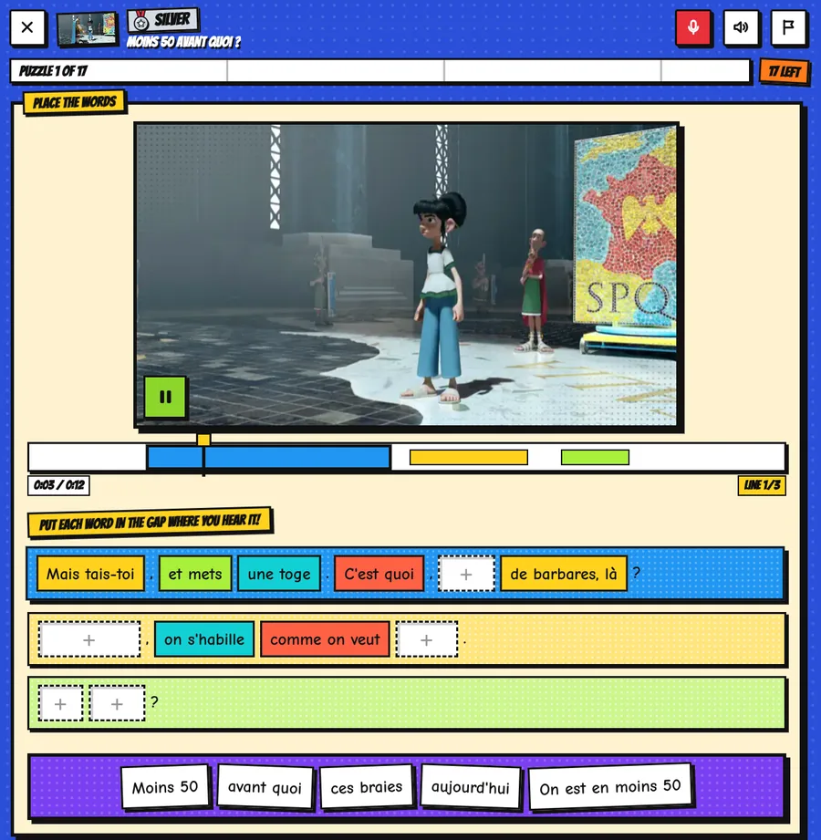

# Frenchirix

Build spaced repetition practice from unadapted target-language video.

Frenchirix is a tool for comprehensible input: it extracts short dialogue scenes from video files of your choice and turns them into listening practice with spaced repetition. Every line of a scene is split into tappable units (a word or an expression), each with its translation and its own looping audio, so real speech at full speed stays understandable.

This is the open-source release of the code behind https://frenchirix.borzov.ca/. The reasoning behind the design is in the blog post: https://www.borzov.ca/posts/frenchirix/

<p align="center">
  
</p>

<p align="center"><em>One puzzle of a practice: the scene plays, and the missing words go into the gaps where you hear them.</em></p>

## What it contains

- **The extraction pipeline** (`frenchirix/`, Python)
  - Point it at your source video files, such as the episodes of a TV show.
  - It reads the subtitle tracks, lets you choose the scenes worth practising, and cuts their audio and frames.
  - It recognises the speech and aligns every word to the audio, so any word or expression can be looped on its own.
  - Each line gets the text as actually spoken, a literal translation, its units and short notes on references and wordplay. These steps need judgement and are done by an LLM or a person, to a specified format.
  - A local review UI (`web/`) plays each scene so you can check it by ear and mark lines to fix.
  - Everything lands in one SQLite database, exported as a content bundle for the web app.
- **The web app** (`app/`, Cloudflare Workers with D1 and Workers AI, React client)
  - A practice per scene: a sequence of short puzzles that goes over every line from several angles, with repetition. More than a dozen puzzle types: matching units to meanings, rebuilding a line, ordering lines, saying a line into the microphone, and others.
  - Spaced repetition through levels: passing a scene's practice makes its next level come due days later, at growing intervals.
  - No puzzle can be failed, and the answers are always one tap away: the point is hearing the dialogue again, not being tested on it.
  - Daily quests, streaks, karaoke for the songs, avatars, rewards and leagues, to keep a learner coming back.
  - Works on phones and tablets, installable, with no registration.

## What it assumes today

The approach works for any language pair. The code was built for one, French learned through English, and a few places still say so:

- **The source file**: a Matroska file (`.mkv`) per episode, with one French audio stream in 5.1 (dialogue is taken from the centre channel, which keeps recognition clean under music) and three SubRip subtitle tracks tagged by language: plain French, French for the hearing impaired (title containing "SDH"; it gives speakers, songs and sounds) and English translating the French. A video that lacks these, such as one downloaded without subtitles or with stereo audio, needs them added or the importer and audio filters changed.
- **The languages**: the stream tags the importer looks for (`frenchirix/importer.py`), the language given to speech recognition (`frenchirix/transcribe.py`, `app/worker/speech.ts`) and the voice of generated question audio are French. The word aligner (`MMS_FA`) covers over a thousand languages. The app's interface is in English and French.
- **The dressing**: the app's theme, mascot, item names and some texts come from the show it was built on. "Adapting the app" below lists them.

[docs/runbook.md](docs/runbook.md), "Another show or your own video sources", has the details.

## What is not here

No video, audio, frames, subtitles or scene database: the material of the show the project was built on is not in this repository. Three example questions in `app/data/questions/` show that file format, and a few tests quote a short line. The screenshot above shows one frame and three lines of a scene, to show what a puzzle looks like. You build content by running the pipeline on video files you have the right to use; [NOTICE.md](NOTICE.md) says what the license covers.

So a fresh clone can run every check and show the app's screens on fixture data, but it has no scene to practise until you build your own content.

## Look at the app

Node 22 or later.

```sh
cd app
PLAYWRIGHT_SKIP_BROWSER_DOWNLOAD=1 npm ci
VITE_FIXTURES=1 npm run dev:web        # http://localhost:5173
```

Fixture mode needs no Worker, no account and no content. Home, the episode timelines and the `/dev` portal work; starting a practice stops at a media error, because there is no audio without content.

With content (below), the full app runs locally with `cp .dev.vars.example .dev.vars` and `npm run dev` ([docs/app-dev.md](docs/app-dev.md)).

## Make content from your own video

Python 3.12 or later with [uv](https://docs.astral.sh/uv/), and ffmpeg. The speech steps want a CUDA GPU with about 4 GB free; they fall back to the CPU.

```sh
uv sync --group asr                    # never a plain `uv sync` afterwards: it removes the speech packages
git config core.hooksPath .githooks    # optional: the pre-commit checks

# one file per episode in content/, its name containing S01E01
.venv/bin/frenchirix import s01e01 --show "My Show"
.venv/bin/frenchirix sheet s01e01      # the cue sheet a scene selector reads
# ... select scenes, render, transcribe, annotate, align, check: docs/runbook.md
.venv/bin/frenchirix serve             # the review UI on http://127.0.0.1:8765
.venv/bin/frenchirix export-app        # the app's content bundle, into app/public
```

[docs/runbook.md](docs/runbook.md) has the fifteen steps in order.

What a source file must contain is under "What it assumes today" above.

**Some steps need judgement, not code**: choosing the scenes, writing each line's text as spoken, its literal translation, its units and notes, and the app's own questions. The author ran these with LLM agents and reviewed the result by ear. The agents' prompt files are not included; [docs/content-steps.md](docs/content-steps.md) specifies each step instead: what goes in, the exact format of what must come out, and what the validators enforce. Any capable LLM, or a person, can do them.

**Models**: Whisper large-v3-turbo through faster-whisper for recognition, torchaudio's `MMS_FA` for word alignment (CC-BY-NC-4.0: non-commercial), and optionally Qwen3-TTS for the spoken audio of questions ([docs/transcription.md](docs/transcription.md), [docs/app-tts.md](docs/app-tts.md)).

## Adapting the app

The app's mechanics do not depend on the show, but its dressing does. Before using it with other content, change:

- `app/data/release.json` (the scene ids the app releases) and `app/data/songs.json` (the karaoke songs): both name the original season's ids. Delete or regenerate them; the export stops with a clear message otherwise.
- `app/shared/speech.ts`: the character names given to speech recognition as a hint.
- The theme: item and achievement names in `app/shared/catalog/`, the "sesterces" and "potions", the gate page's texts in `app/shared/i18n/`, `app/public/manifest.webmanifest`, the mascot and icons (`app/web/src/pwa/druid.ts`).
- The `unlock-all` achievement in `app/shared/catalog/achievements.ts`, which hard-codes 203 scenes.
- The `/dev` screens and some tests, which name scene ids of the original season.

## Deploying your own copy

[docs/app-release.md](docs/app-release.md) has the procedure. In short: put your D1 database id and your host name into `app/wrangler.jsonc`, set the three secrets `SESSION_SECRET`, `GATE_PASSWORD` and `ADMIN_PASSWORD` with `wrangler secret put`, and deploy with `app/tools/deploy.sh`, which refuses when a check fails.

Know the security model before putting learners on it:

- The whole site sits behind one shared password (the gate). It is the only barrier in front of the accounts and the content.
- Accounts are made to be effortless: no email, a funny name and a three-digit PIN shown in the profile. That is convenience, not protection. Keep nothing in an account that needs protecting.
- A learner's speech is sent to Workers AI for recognition; the transcripts are logged for 180 days, and karaoke recordings are kept on the server. Check what the privacy rules where you live require, above all if your learners are children.
- Problem reports and log events are accepted from any browser past the gate, so they are untrusted input wherever they are read ([docs/checks.md](docs/checks.md), "The session-start check").

## Checks

```sh
.venv/bin/python -m pytest             # the pipeline's tests
cd app && npm run check                # type checks, unit tests, and every practice of the bundle
```

On a clone without content, the tests that need real scenes are skipped. [docs/checks.md](docs/checks.md) explains every check, including the one that searches for puzzles a learner could get stuck in.

## Documentation

The docs were written for working on this project with AI coding agents, and they work as well for people: [AGENTS.md](AGENTS.md) holds the glossary and the rules, and points to one focused file per subject in `docs/`. Good places to start:

- [docs/intent.md](docs/intent.md): what the app is meant to be and why, largely in the author's own words. "The user" in the docs is the author.
- [docs/app-architecture.md](docs/app-architecture.md): the stack, the content bundle, the contract every puzzle type follows.
- [docs/app-games.md](docs/app-games.md): the puzzle types, the audio engine, the speaking puzzles.
- [docs/runbook.md](docs/runbook.md) and [docs/content-steps.md](docs/content-steps.md): the pipeline.
- [docs/app-status.md](docs/app-status.md): known rough edges and what was never verified.

## Status

A working project released as it is, not a product. It was built around one show, and it is shared so that others can reuse the pipeline, the puzzle designs or the app. Expect to read the docs and change code. Issues and pull requests are welcome; there is no promise of support.

## License

The code and documentation are under the [MIT license](LICENSE). The fonts and any show's material are not: see [NOTICE.md](NOTICE.md). Frenchirix is an independent, non-commercial educational project, not affiliated with or endorsed by the rights holders of any show.
